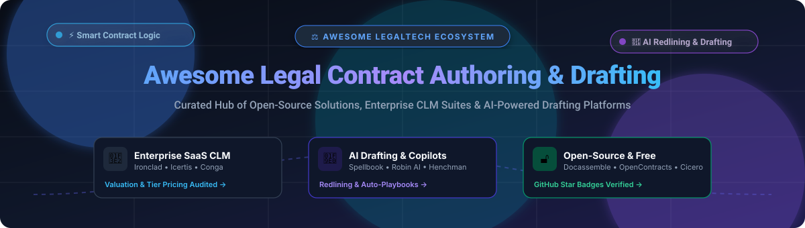

# ⚖️ Awesome Legal Contract Authoring & Drafting 📜

**A comprehensive, curated catalog of the world's best Legal Contract Authoring, Document Assembly, AI Redlining, and Contract Lifecycle Management (CLM) tools.** Featuring in-depth pricing disclosures, company scale benchmarks (valuation/revenue), free tier limits, and ranked open-source software with live Stars_Badges.

---

## 📑 Table of Contents
- [🌐 Sector Overview & Market Dynamics](#-sector-overview--market-dynamics)
- [🏢 SaaS & Hosted Commercial Platforms](#-saas--hosted-commercial-platforms)
- [🔓 Open-Source Software & Toolkits](#-open-source-software--toolkits)
- [✨ Key Selection Matrix](#-key-selection-matrix)
- [🤝 Contributing](#-contributing)
- [💖 Support](#-support)
- [⭐ Star History](#-star-history)
- [📄 License](#-license)

---

## 🌐 Sector Overview & Market Dynamics

The global **Contract Lifecycle Management (CLM) and Legal Document Automation software market** is estimated at **$1.8B – $3.3B in 2024**, projected to surge past **$4.6B – $9.5B by 2030–2032** at an annual compound growth rate (**CAGR of 11.6% – 13.2%**). 

The market remains **moderately fragmented** rather than a winner-take-all monopoly: while enterprise heavyweights (DocuSign, Icertis, Conga, and Ironclad) hold an aggregate ~28%–35% market share, strong regional jurisdictional nuances, strict compliance mandates (GDPR, HIPAA, SOC 2), and specialized vertical requirements have fostered a vibrant, multi-polar ecosystem. Simultaneously, rapid GenAI disruption is accelerating specialized point solutions (LLM-native drafting add-ins, automated redline playbooks, and local self-hosted open-source stacks).

---

## 🏢 SaaS & Hosted Commercial Platforms

Below is the audited comparison of commercial Contract Authoring, Negotiation, and CLM suites. Products are sorted in **descending order by company scale (Valuation / Revenue / Market Cap)**.

| 🏢 Platform | 🌟 Key Focus & Core Strengths | 💰 Transparent Starting Tier Price | 🎁 Free Tier Limits / Free Trial Window | 📊 Company Scale (Valuation / Revenue) |
| :--- | :--- | :--- | :--- | :--- |
| **Microsoft Word Online (M365)** | Universal standard doc processor with real-time co-authoring & native legal redlining | **$6.00/user/mo** (*M365 Business Basic*, annual commitment) | **100% Free Forever Plan**: Full web browser access with 5 GB OneDrive cloud storage | **~$3,100,000,000,000 ($3.1T Market Cap)** / ~$245B+ Annual Revenue |
| **Icertis Contract Intelligence** | Enterprise CLM suite with AI governance, ERP integrations & contract compliance | **$300,000/year** (Enterprise deployment platform license baseline) | **Demo-Only Model**: No self-service free trial; guided sandboxed POC provided upon enterprise qualification | **$5,000,000,000 ($5.0B Valuation)** / ~$350M+ ARR |
| **Ironclad (Workflow Designer)** | High-velocity workflow builder, collaborative redlining & generative AI ("Jurist") | **$50,000/year** (Mid-Market Core deployment tier) | **Demo-Only Model**: No self-service free trial; tailored guided pilot environments available on request | **$3,200,000,000 ($3.2B Valuation)** / ~$200M+ ARR |
| **PandaDoc** | Sales proposal drafting, contract authoring, template variables & built-in e-signature | **$19.00/seat/mo** (*Starter Tier*, billed annually) | **14-Day Free Trial** (Full Starter features) + **Free Forever Plan** (Up to 60 docs/year for basic eSign) | **$1,000,000,000 ($1.0B Valuation)** / ~$100M+ ARR |
| **Conga Contracts (Conga CLM)** | Robust Salesforce-native authoring, clause libraries, CPQ integration & redlining | **$35.00/user/mo** (*Standard Business Seat*, billed annually) | **Demo-Only Model**: No public free trial; guided sandbox environment provisioned by enterprise sales | **$715,000,000 ($715M Valuation)** / ~$250M+ ARR |
| **Lexion (Docusign IAM)** | AI-driven agreement repository, intake ticketing & native MS Word redlining add-in | **$15,000/year** (Base organizational license, up to 10 users) | **Demo-Only Model**: 0 self-serve trial days; personalized workflow evaluation sandbox on sales demo | **$165,000,000 ($165M Acquisition Price)** / ~$15M ARR |
| **ContractPodAi (Leah Legal AI)** | End-to-end CLM with generative AI clause authoring, translation & risk analytics | **$50,000/year** (Standard corporate deployment tier) | **Demo-Only Model**: No public free tier or self-service trial; private customer pilot via sales inquiry | **~$350,000,000 ($350M Est. Valuation)** / ~$50M+ ARR |
| **Robin AI** | AI assistant for contract review, clause comparisons & automated redline suggestions | **$120.00/seat/mo** (*Pro Tier*, billed annually) | **Free Forever Plan**: 1 user, up to 10 AI chat queries & document inspections per day | **~$150,000,000 ($150M Est. Valuation)** / ~$72M Total Raised |
| **Spellbook** | Generative AI copilot built into Microsoft Word for clause drafting & playbook review | **$99.00/user/mo** (*Starter Tier*, billed annually) | **7-Day Free Trial**: 100 AI queries/credits across Word & Google Docs add-ins | **~$80,000,000 ($80M Est. Valuation)** / ~$30M Total Raised |
| **Henchman (Lexis Create+)** | Clause retrieval engine surfacing vetted historical clauses from DMS inside Word | **$85.00/user/mo** (*Base Drafting Seat*, billed annually) | **Demo-Only Model**: No public self-service trial; custom sandbox evaluation during firm onboarding | **~$40,000,000 ($40M Est. Acq. Value by RELX)** / ~$7M ARR |

---

## 🔓 Open-Source Software & Toolkits

Self-hosted, transparent, and developer-friendly tools for guided document assembly, digital contracts, and automated legal drafting. Listed in **descending order by GitHub Stars_Count**.

| 📦 Repository & Project | 🌟 GitHub_Stars_Badge | 🛠️ Tech Stack | 💡 Core Capabilities for Contract Authoring & Drafting |
| :--- | :---: | :--- | :--- |
| **[Documenso](https://github.com/documenso/documenso)** |  | TypeScript, Next.js, Prisma, PostgreSQL | Next-generation open-source document signing, custom contract template configuration, and approval workflows. |
| **[OpenSign](https://github.com/OpenSignLabs/OpenSign)** |  | Node.js, React, MongoDB | Free & self-hosted DocuSign/PandaDoc alternative with PDF drafting, dynamic signature placeholders, and team controls. |
| **[LibreOffice Core](https://github.com/LibreOffice/core)** |  | C++, Python, XML | The gold standard open-source desktop & headless document processor for programmatic DOCX/ODT template drafting. |
| **[OpenContracts](https://github.com/Open-Source-Legal/OpenContracts)** |  | Python, Django, TypeScript, OCR | Open-source document intelligence & DMS designed for parsing, structural clause annotation, and LLM drafting pipelines. |
| **[Docassemble](https://github.com/jhpyle/docassemble)** |  | Python, YAML, Markdown, Docker | World's premier expert system for guided interview-driven legal document assembly and conditional contract generation. |
| **[Accord Project Cicero](https://github.com/accordproject/template-archive)** |  | JavaScript, Concerto, WebAssembly | Linux Foundation open-source framework for smart computable legal contracts, parameter binding, and machine execution. |
| **[Accord Concerto](https://github.com/accordproject/concerto)** |  | TypeScript, JSON Schema | Cross-platform data modeling language for standardizing contract schemas, terms, and digital transaction primitives. |
| **[OCA Contract](https://github.com/OCA/contract)** |  | Python, Odoo | Community Association module providing structured recurring contract authoring, invoicing terms, and lifecycle state machines. |
| **[Steedos Contract](https://github.com/steedos/contract)** |  | Node.js, Meteor, MongoDB | Open-source enterprise CLM application supporting contract drafting, approval flows, versioning, and lifecycle management. |
| **[Legal Skills Open](https://github.com/ThomasMoreAI/legal-skills-open)** |  | Python, MCP, JSON | Model Context Protocol (MCP) agent skills for automated legal analysis, contract term validation, and drafting assistance. |
| **[Vaquill Word Add-in](https://github.com/Vaquill-AI/ms-word-addin)** |  | TypeScript, Office.js, React | Open-source Legal AI assistant plugin for Microsoft Word supporting contract reviews, custom playbooks, and drafting panes. |
| **[Docassemble AssemblyLine](https://github.com/SuffolkLITLab/docassemble-AssemblyLine)** |  | Python, YAML | Rapid deployment framework for automated legal intake forms and dynamic contract package generation. |
| **[Judicex](https://github.com/JustVugg/judicex)** |  | TypeScript, Python, LLM RAG | Evidence-grounded legal AI workspace for drafting legal filings, analyzing contractual obligations, and verifying clauses. |
| **[SignCraft](https://github.com/Steviewonders99/signcraft)** |  | Next.js, Node.js, AI SDK | Open-source contract drafting and review platform with AI-powered clause risk checking and document signing. |
| **[LegalDown](https://github.com/ForLegalAI/LegalDown)** |  | Markdown, Python | Specialized plain-text format for drafting legal agreements with dynamic clause cross-referencing and Git version control. |

---

## ✨ Key Selection Matrix

| Organizational Profile | Recommended Path | Primary Tools |
| :--- | :--- | :--- |
| **Global Enterprise & Multi-Entity** | End-to-end CLM with enterprise governance & ERP sync | [Icertis](https://www.icertis.com) • [Ironclad](https://ironcladapp.com) • [Conga](https://conga.com) |
| **High-Volume Sales & Commercial Ops** | Rapid self-serve templates, variable merge & signature | [PandaDoc](https://www.pandadoc.com) • [OpenSign](https://github.com/OpenSignLabs/OpenSign) • [Documenso](https://github.com/documenso/documenso) |
| **Boutique Law Firms & Legal In-House** | In-editor AI copilots for redlining, clause search & drafting | [Spellbook](https://www.spellbook.com) • [Robin AI](https://www.robinai.com) • [Henchman](https://henchman.io) |
| **Legal Aid, Public Sector & Self-Hosted** | Zero-license cost, open-source guided document assembly | [Docassemble](https://github.com/jhpyle/docassemble) • [OpenContracts](https://github.com/Open-Source-Legal/OpenContracts) • [Cicero](https://github.com/accordproject/template-archive) |

---

## 🤝 Contributing

Contributions, feature requests, and suggestions are welcome!
1. 🍴 Fork the repository.
2. 🌿 Create your feature branch (`git checkout -b feature/awesome-addition`).
3. 💾 Commit your changes (`git commit -m 'Add awesome legal drafting tool'`).
4. 🚀 Push to the branch (`git push origin feature/awesome-addition`).
5. 📬 Open a Pull Request.

---

## 💖 Support

Thank you so much for exploring and supporting **Awesome Legal Contract Authoring & Drafting**! 🌟

If you found this resource helpful, please consider:
- ⭐ **Starring** the repository on GitHub
- 🍴 **Forking** and contributing new legaltech tools or updates
- 📢 **Sharing** this curated list with legal engineers, attorneys, and developers
- ☕ **Buying a coffee** to sponsor ongoing curation and maintenance via the [GitHub Sponsors Dashboard](https://github.com/sponsors/ishandutta2007)

---

## ⭐️ Star History

---

## 📄 License

This repository is distributed under the [MIT License](LICENSE).
